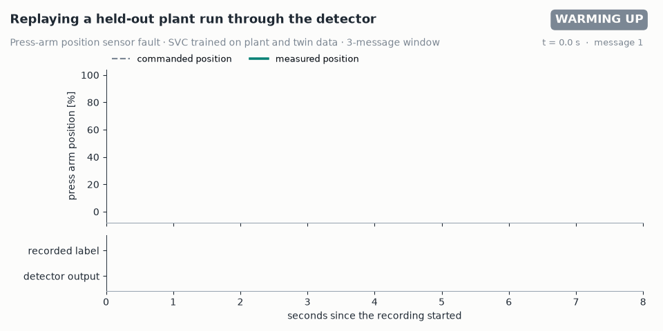
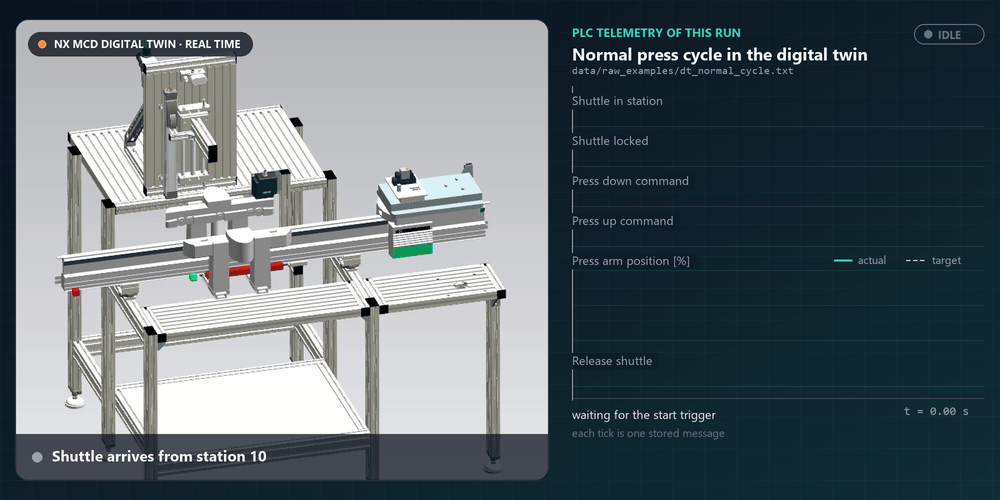
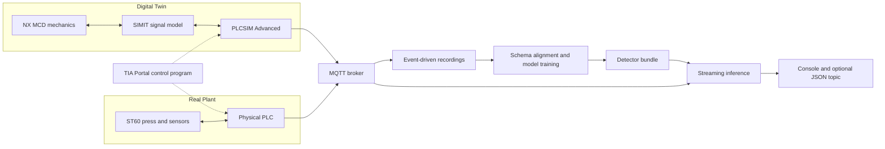
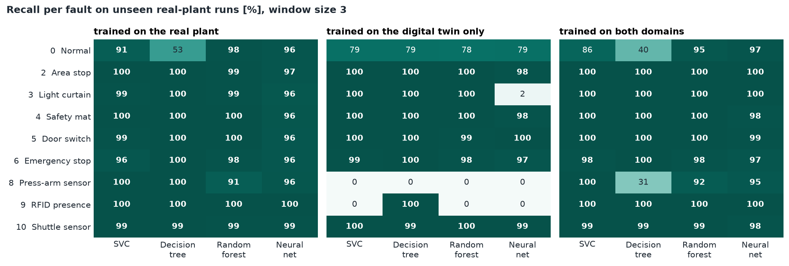

<h1 align="center">
  
</h1>

<p align="center">
  
  
  
  
  
  
</p>

<p align="center"><b>Can a model trained on a virtual machine recognize faults on the real one?</b></p>

This project investigates that question on an industrial pressing station. It connects a Siemens-based virtual commissioning workflow to a reproducible Python fault-classification pipeline, compares real-plant and digital-twin training data, and runs the resulting detector on an MQTT stream.

The repository includes **97 recorded experiments, 51 process signals, nine operating classes, and 100 benchmark configurations**. No PLC, simulator, or pretrained binary is needed to reproduce the offline experiments.



*A held-out plant recording, never used for training, replayed through the same parsing, buffering and prediction code as the MQTT service (first 8 s shown). The position reading freezes while the arm is commanded back up, and the detector flags the fault at the labelled onset. It also raises a few short false alarms, mostly during the fast downstroke.*

> **Key result:** at a three-sample window, the combined-data SVC reaches **96.99% accuracy / 98.44% macro F1**. Training the same model on twin data alone and testing on the plant yields **48.47% accuracy**. A useful digital twin is not automatically an interchangeable source of training data.

## The System

The ST60 station presses a relay into its socket on a shuttle. The digital twin reproduces the station's motion, control interfaces, and selected faults using NX Mechatronics Concept Designer, SIMIT, and PLCSIM Advanced. Both domains expose a common PLC telemetry contract.

<p align="center"></p>

*The NX MCD digital twin running one normal press cycle in real time, next to the PLC telemetry the data acquisition client recorded during that run ([dt_normal_cycle.txt](data/raw_examples/dt_normal_cycle.txt)). The recording starts when the shuttle reports in station and stops when it leaves. Only changed messages are stored, one tick each. The footage is cropped from a project screen recording; see the [architecture guide](docs/architecture.md) for signal-level connections.*

<p align="center"></p>

<details>
<summary>The same flow as a Mermaid diagram</summary>



</details>

**Monitoring only:** predictions do not control actuators or replace the station's safety PLC, interlocks, or emergency-stop circuit.

### How a Twin Run Is Recorded

<p align="center"></p>

SIMIT scenario scripts and the data acquisition (DAQ) client coordinate through command and acknowledgement bytes in shared memory. The shuttle-in-station signal in the PLC telemetry starts and stops each recording. Transcribed scenario scripts are in [simit/](simit/README.md).

## Run It

Open a terminal in this repository. Python 3.10+ is required; Python 3.14 was used for the included benchmark.

```bash
python -m venv .venv
```

Activate the environment with `.venv\Scripts\Activate.ps1` on Windows PowerShell, or `source .venv/bin/activate` on Linux/macOS. On Windows, `py` can be used in place of `python` to create the environment.

```bash
python -m pip install -e ".[dev]"
ml-manufacturing train --domain combined --model svc --window 3 --out models/press.joblib
ml-manufacturing evaluate --model models/press.joblib --domain combined --confusion-matrix results/local_confusion.png
python -m pytest
```

To reproduce all five scenarios, four classifiers, and five window sizes:

```bash
ml-manufacturing benchmark --windows 0 3 5 10 20 --out results/local_benchmark.csv
```

`0` means no windowing; `3` means the three most recent samples. Windows stay inside each recording, and their label is the last sample's label.

## What the Experiments Show

<p align="center"></p>

Fresh benchmark, seed 42, window size 3. These are held-out recording results, not production reliability guarantees.

| Training → Test | SVC | Decision Tree | Random Forest | MLP |
|---|---:|---:|---:|---:|
| Real → Real | 97.56% | 88.49% | 96.86% | 97.50% |
| Twin → Twin | 93.68% | 98.47% | 96.74% | 91.75% |
| Real → Twin | 61.01% | 44.18% | 83.30% | 68.00% |
| Twin → Real | 48.47% | 68.22% | 48.32% | 45.45% |
| Combined → Combined | 96.99% | 76.86% | 97.03% | 97.68% |

Accuracy alone hides important differences. Several binary fault states transfer well, while the press-arm sensor fault and normal operation expose a substantial domain gap. Large event-count windows also remove short recordings, changing which classes can be evaluated.



See [experimental results](docs/results.md) for macro metrics, preprocessing differences, clipping sensitivity, historical report comparisons, and the limits of this evaluation. Machine-readable outputs are in [results/](results/).

## Stream a Recording

With a local MQTT broker running, start the detector:

```bash
ml-manufacturing serve --model models/press.joblib --host localhost --changes-only
```

In a second terminal with the same environment active:

```bash
ml-manufacturing replay data/real_plant/test/rp_c08_run4.csv --host localhost
```

Both commands default to `Station60_Press_MQTT_Topic`. Playback uses recorded timestamps when present and synthetic pacing otherwise. See [MQTT operation](docs/mqtt.md) for authentication, prediction messages, and safe lab deployment.

<p align="center"></p>

*The same two commands replaying a different held-out plant run, an emergency stop (`rp_c06_run3.csv`). The terminal output is generated by the package's own streaming code. The detector reports the emergency stop one message after its labelled onset at 2.2 s. The brief press-arm alarm at 0.76 s is a false positive: the arm is already moving down, but the position reading has not updated yet.*

## Inside the Repository

| Path | Contents |
|---|---|
| [src/ml_manufacturing/](src/ml_manufacturing/) | DAQ parsing, labels, per-recording windows, training, evaluation, MQTT inference and replay |
| [data/](data/README.md) | Normalized real/twin recordings, preserved train/test assignments, provenance manifest, raw examples |
| [results/](results/) | Reproduced benchmarks, per-fault recall, domain-gap analysis, historical report tables |
| [docs/architecture.md](docs/architecture.md) | Hardware/software connections, signal path, training and inference flowcharts |
| [docs/results.md](docs/results.md) | Findings, evaluation protocol, caveats and reproducibility |
| [simit/](simit/README.md) | Simulation-only fault-scenario script transcriptions |
| [plc/](plc/README.md) | FC9 SCL telemetry body and its signal-order contract |
| [scripts/](scripts/) | Dataset normalization, reproducible figures, and the animated README artwork |
| [tests/](tests/) | Parser, schema, window alignment, detector, CLI and streaming tests |

## Engineering Choices

- **One signal contract:** real and simulated recordings are aligned by signal name, not their original column positions.
- **No label leakage:** `label` and timestamps never enter the classifier's feature vector.
- **Recording-level separation:** supplied train/test assignments are preserved; windows never cross experiment boundaries.
- **Train-only scaling:** the fitted scaler travels with the model, signal schema, class mapping, and window size.
- **Bounded streaming state:** a rolling window emits predictions after warm-up and can discard unchanged telemetry.
- **Reproducible evidence:** numerical results and figure generators are included; historical scores are labelled separately.
- **Automated checks:** GitHub Actions is configured for Windows and Linux on Python 3.10, 3.12, and 3.14, including tests, lint, formatting, and wheel creation.

## Scope and Provenance

Developed as a **Hochschule Darmstadt project** using the AutFab ST60 pressing-station hardware setup provided by Hochschule Darmstadt.

This is a curated, runnable research reconstruction of the project workflow. It is not a safety-certified diagnostic system, a remaining-useful-life predictor, or a claim of zero-shot transfer to other machines. Binary safety labels largely reflect signals already available to the PLC; the more demanding question is transfer of process-related faults.

Original reports, presentations, personal metadata, proprietary engineering project containers, old virtual environments, and legacy model binaries are intentionally not redistributed. The separate earlier-group report supplied as background is not included and its results are not presented as this project's work.

Python code is provided under the [MIT license](LICENSE). See [data provenance](data/README.md) and [simulation notes](simit/README.md) for the scope of the included experimental material and external tool requirements.