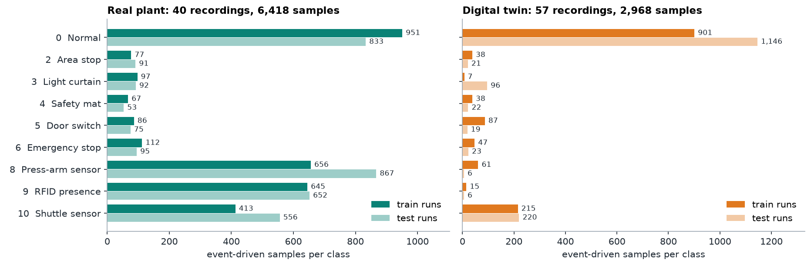

# Experimental Data

[Project overview](../README.md) | [Results](../docs/results.md) | [Signal contract](../docs/architecture.md#signal-contract)

These are recorded ST60 experiments from the project's real plant and digital twin, not generated demo data. The files have been normalized for consistent parsing and cross-domain comparison. Hochschule Darmstadt provided the AutFab hardware setup.

## Coverage

| Domain | Train recordings | Test recordings | Train samples | Test samples |
|---|---:|---:|---:|---:|
| Real plant | 21 | 19 | 3,104 | 3,314 |
| Digital twin | 29 | 28 | 1,409 | 1,559 |
| Total | 50 | 47 | 4,513 | 4,873 |



Sampling is **event-driven**: the acquisition client retained changes in the process signals. A sample count is not a duration. A stopped deterministic simulation can produce very few new events, even during a long acquisition interval. Repeated normal states in different recordings are expected.

## Fault Catalogue

| Code | Class | Indicator or experimental basis |
|---|---|---|
| 0 | Normal operation | No injected fault label |
| 2 | Area stop | `Bereichshalt Nicht == 0` |
| 3 | Light curtain interrupted | `LichtvorhangFrei == 0` |
| 4 | Safety mat pressed | `SchaltmatteGedrueckt == 1` |
| 5 | Safety door opened | `SchalterTuerZu == 0` |
| 6 | Emergency stop | `KeinNotHaltExtern von St10 == 0` |
| 8 | Press-arm position sensor failure | Injected/frozen position feedback; supplied labels |
| 9 | RFID presence detection failure | Supplied labels; plant indicator: shuttle present and RFID absent |
| 10 | Shuttle-in-station sensor failure | Supplied labels; plant indicator: shuttle absent and RFID present |

Codes are preserved from the project, not renumbered. The larger catalogue in the Python schema includes unrepresented cases; it does **not** imply that the trained models recognize those cases. These experiments use one target class per sample, not multi-label diagnosis of simultaneous faults.

## File Contract

Each CSV contains a header and 59 columns:

1. Seven timestamp fields: `Year, Month, Day, Hour, Minute, Second, Nanosecond`.
2. The 51 signals in the exact order defined by [schema.py](../src/ml_manufacturing/schema.py).
3. Integer target `label`.

CSV files are comma-separated UTF-8. Original PLC tag names remain recognizable; German names are part of the machine interface, not personal attribution. Pressure values are raw analog counts, not bar. The fractional timestamp field is **nanoseconds**, not milliseconds. Timestamps are retained for inspection and replay but excluded from model input.

Filenames follow `rp_c08_run4.csv` or `dt_c08_run4.csv`: domain, injected case, and chronological run number within that domain/case. Run numbers do not define the split. Use [manifest.csv](manifest.csv), whose paths are relative to this directory.

| Manifest field | Meaning |
|---|---|
| `file` | Relative recording path |
| `domain` | `real_plant` or `digital_twin` |
| `split` | Original `train` or `test` assignment |
| `fault` | Injected case for the recording; normal prefixes were normalized to 0 |
| `run` | Chronological run index within domain and case |
| `samples`, `fault_samples` | Total rows and rows carrying a nonzero target |
| `fault_delay_ms` | Timing encoded by the original filename when available; blank means unspecified |
| `recorded_at` | Acquisition date/time taken from the original filename, with no inferred timezone |
| `note` | Relevant experimental or normalization note |

## Normalization and Provenance

The 97 files originate from the supplied working data directories `RealPlant/RealPlant_TrainData`, `RealPlant/RealPlant_TestData`, `DigTwin/DigitalTwin_TrainData`, and `DigTwin/DigitalTwin_TestData`. The report describes splitting fault recordings by injection timing; this repository preserves the actual file assignments instead of shuffling overlapping windows.

[build_dataset.py](../scripts/build_dataset.py) records the conversion procedure:

- Normalize nested quoting in headers and use the canonical PLC signal order.
- Verify and remove the extra constant-zero field immediately before `Label` in the twin exports. Those rows were one field wider than their header; a naive header-based import can silently shift the feature alignment.
- Correct **252 pre-fault samples** in the twin emergency-stop recordings using the named emergency-stop signal. Other supplied targets are preserved.
- Retain timestamps and all 51 signals, rename files without personal identifiers, and write the manifest.

This is a documented correction of supplied data, not a new set of independent ground-truth annotations. The older raw folder is not needed to use the normalized data. To rebuild from that source separately:

```bash
python scripts/build_dataset.py --source /path/to/original/Data --out /path/to/rebuilt-data
```

Do not point this command at the curated dataset as its source. Do not mix the legacy flattened window exports with these files: some used a different width and included the target among the window inputs.

## Raw Examples

[raw_examples/](raw_examples/) contains two headerless DAQ messages-per-line recordings: a normal twin cycle and a press-arm sensor fault experiment. Each row has seven timestamp fields and 51 signals, with no target. These examples are excluded from the benchmark manifest.

```bash
ml-manufacturing convert data/raw_examples/dt_press_arm_sensor_2000ms.txt --fault 8 --method delay --delay-ms 2000 --out-dir data/labelled
```

The delay method uses elapsed time from the first recorded sample as a proxy for injection time. The automatic method chooses a signal rule when one exists, then a supplied delay, and otherwise labels the whole recording. For a new fault without a rule, supply a verified delay rather than relying on that fallback. Rule-based conversion latches a fault from its first matching sample until the end of the recording; the dataset builder's emergency-stop correction instead checks each row directly.

## Interpretation and Use

The data describe one laboratory station and one simulation configuration. High scores on safety bits can amount to recovering an existing PLC indication. They are not proof of fault prediction before onset, diagnosis of unseen failure modes, or safety reliability. The twin's short recordings and missing analog variation materially affect transfer and class coverage.

The code license does not grant rights to Siemens software, CAD models, or the facility itself. Use of the experimental recordings and cropped project screenshots remains subject to any applicable project/facility permissions; those cannot be verified from the files alone. No personal identities, original reports, or proprietary project containers are included.