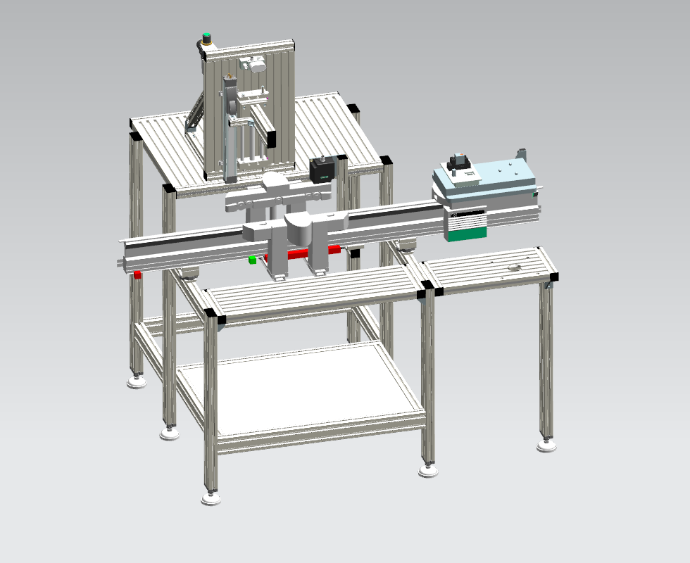
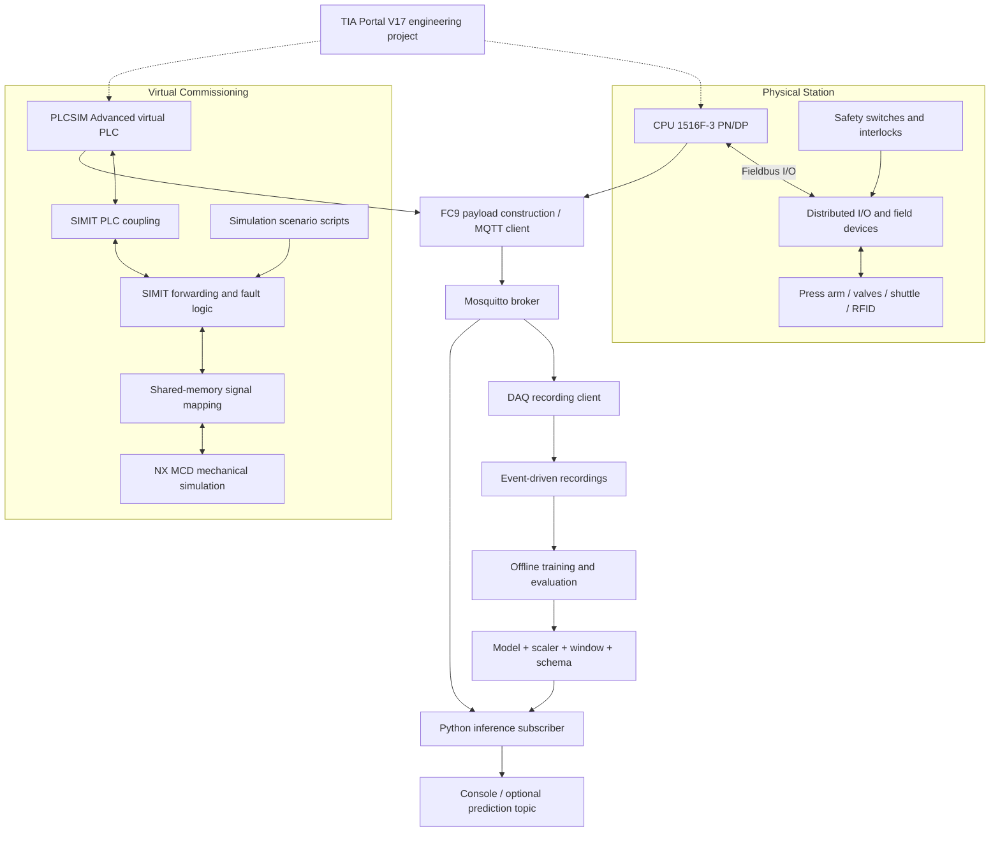
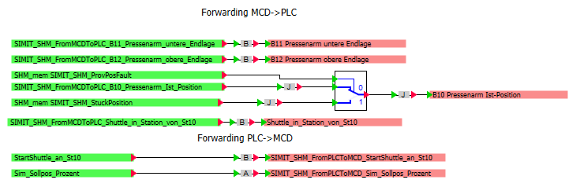
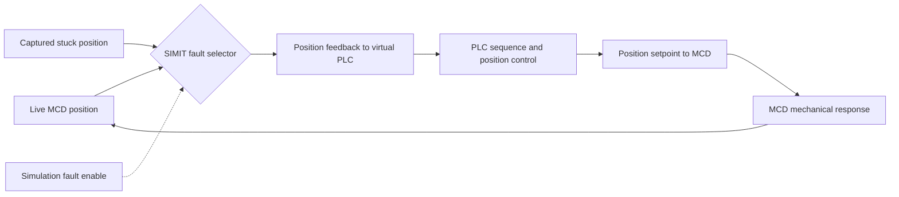
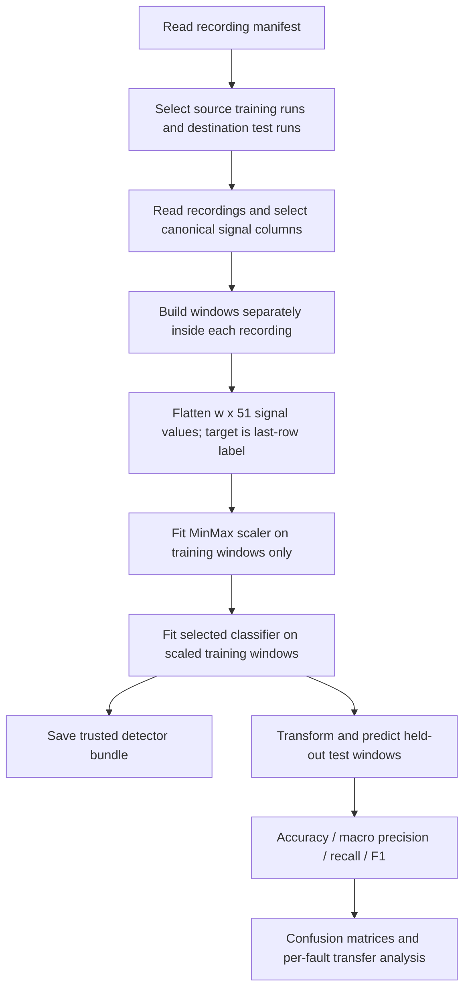
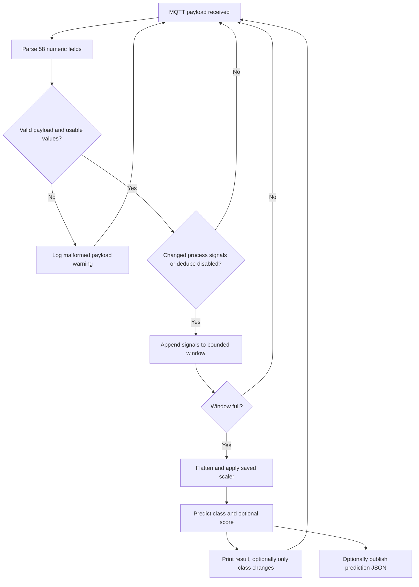
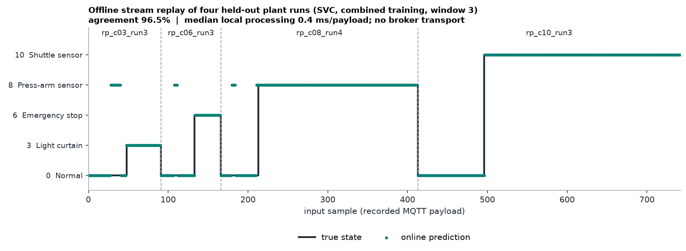

# System Architecture

[Overview](../README.md) | [MQTT operation](mqtt.md) | [Data](../data/README.md)

## Physical and Virtual Station

ST60 receives a shuttle carrying a relay/socket assembly, locks it, performs the pressing cycle, returns the press arm, and releases the shuttle. The physical PLC remains responsible for motion and safety. The ML detector only observes telemetry alongside that control system.

The cropped image above shows the project digital twin, not a photograph of the physical station.

The shared publisher box represents equivalent telemetry logic in the two PLCs, not a third PLC. Run one selected source on the topic; do not interleave two machines into one inference buffer. Dotted arrows indicate engineering configuration, not telemetry. External engineering tools, the original DAQ executable, device configuration, and licensed project containers are not included.

## Signal Exchange

The forwarding chart passes lower/upper end-position signals, press-position feedback, and shuttle presence from MCD toward the virtual PLC. In the opposite direction, shuttle release and the simulated position setpoint reach MCD. For the stuck-sensor experiment, a SIMIT selector substitutes a captured position value for live position feedback.

The substituted value changes what the controller observes; it does not make every mechanical or pneumatic fault realistic. In the supplied recordings, actual valve-pressure feedback is not reproduced by the twin.

## Signal Contract

The project's later FC9 export uses **seven timestamp fields plus 51 signals**. The earlier background report uses a different 56-feature schema and must not be used to decode these recordings.

| Feature positions, 1-based | Group | Count |
|---|---|---:|
| 1-4 | Shuttle hand-over | 4 |
| 5-13 | Station state and operating mode | 9 |
| 14-26 | Safety status and feedback | 13 |
| 27-33 | Press end positions and position control | 7 |
| 34-37 | M1/M2 target and actual valve pressure | 4 |
| 38-47 | RFID read/write/reset | 10 |
| 48-51 | Field-device diagnostics | 4 |

Canonical names, addresses, types and English descriptions live in [schema.py](../src/ml_manufacturing/schema.py). The [PLC reference](../plc/README.md) includes the payload-building SCL body. The last four signals follow **executable append order**, including main PLC before ET200S; the historical FC9 feature-number comments reverse those two numbers.

Raw timestamps have a nanosecond fractional field. Wire messages are numeric, comma-separated, and contain no label. The Python parser requires the exact field count, removes the timestamp prefix and converts the 51 signals to numeric input. A same-width but reordered PLC payload cannot be detected automatically: verify tag order before connecting a new publisher.

## Training Flow

At window 3, each input is `[sample t-2: 51 signals, sample t-1: 51 signals, sample t: 51 signals]`, giving 153 features. Neither the target nor absolute time is included. The model classifies the current state; it does not forecast a future event.

## Streaming Flow

The parser detects wrong widths and nonnumeric signal values; classifier/scaler validation handles invalid numeric input. There is no physical plausibility validator or automatic sensor-schema discovery. The live buffer spans the continuous stream, unlike offline windows split by recording. Restart the subscriber between independently replayed experiments when exact offline parity is needed. A connection break or a long silence does not currently clear that buffer automatically.

This trace passes four held-out recordings sequentially through one local predictor with deduplication disabled and a continuous buffer. It demonstrates the inference path, not broker transport, live hardware validation, or end-to-end latency measurement.

## Code Ownership

| Module | Responsibility |
|---|---|
| `schema` | Signal order, metadata and case names |
| `daq` | File/wire parsing and optional raw-data labelling |
| `datasets` | Manifest paths and experiment selection |
| `windowing` | Per-recording windows and target alignment |
| `models`, `detector` | Classifier factories, fitted preprocessing, bundles and metrics |
| `benchmark`, `plotting` | Scenario comparisons and confusion-matrix rendering |
| `realtime`, `replay` | Stream buffering, MQTT subscriber and recording publisher |
| `cli` | User-facing commands |

## Safety Boundary

The inference path is advisory and has no actuator-write interface. Communication loss, a normal label, or a high probability score must never release a safety interlock. Any plant use needs an independently engineered watchdog, access control, payload validation, operational alarm policy, and fresh hardware validation. Fault-injection scripts belong only in an isolated simulation environment.