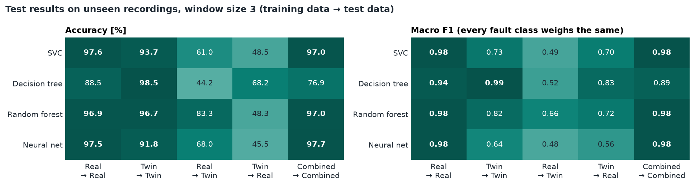
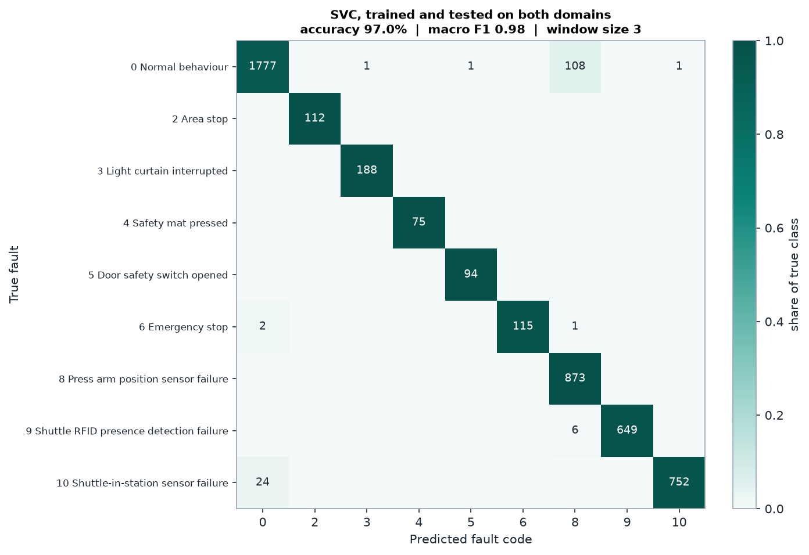
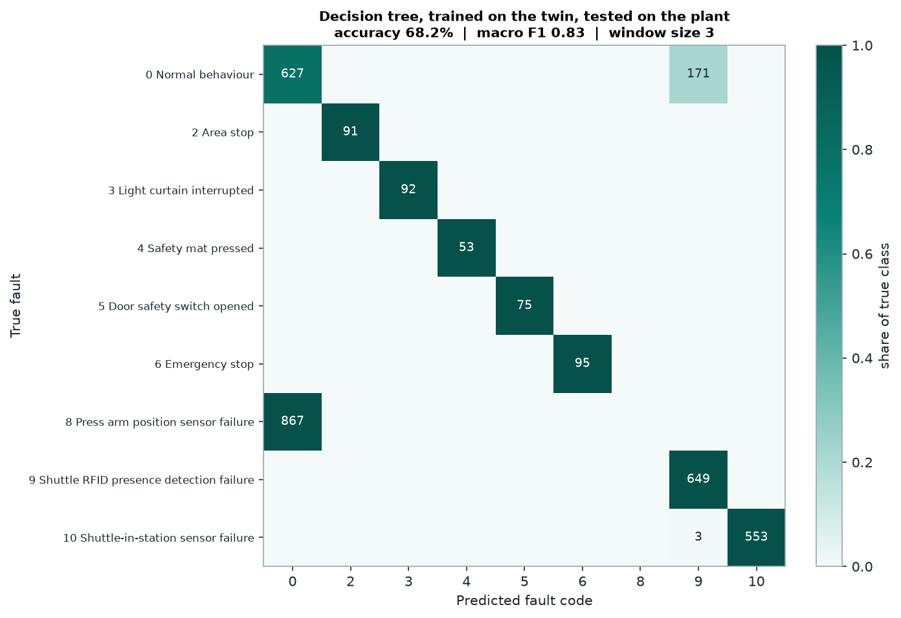
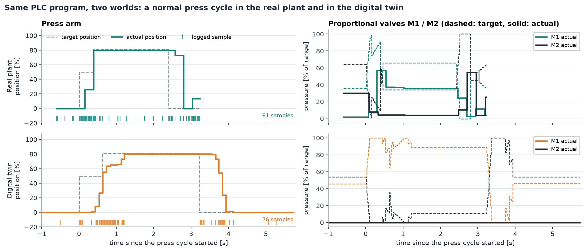
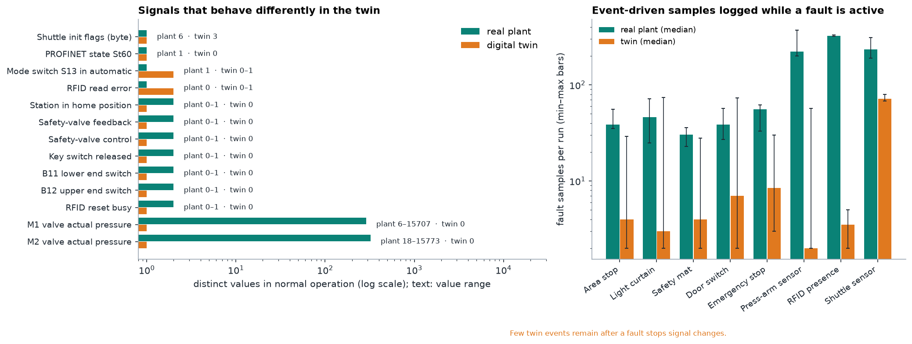
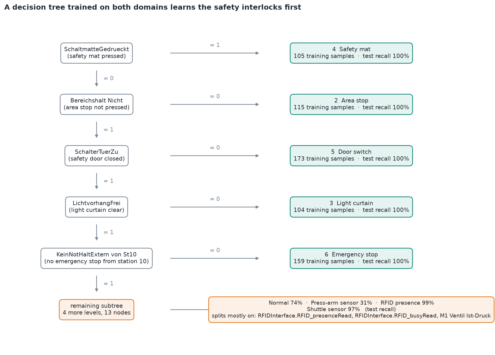
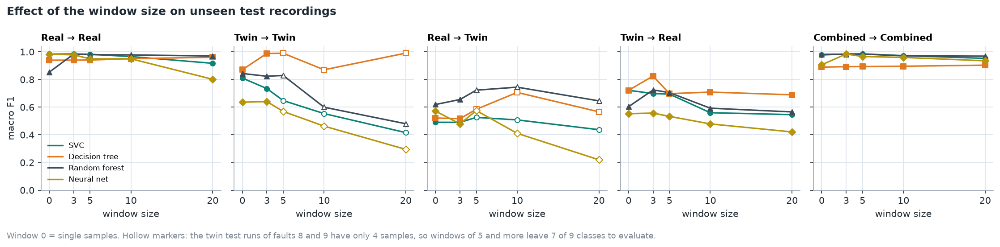
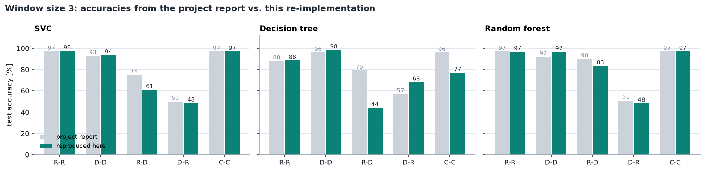

# Experiments and Results

[Overview](../README.md) | [Data](../data/README.md) | [Architecture](architecture.md)

## Question and Protocol

The study compares training on real-plant recordings, digital-twin recordings, and their union. `R-R`, `D-D`, `R-D`, `D-R`, and `C-C` mean training domain followed by test domain. Cross-domain tests use only the destination's supplied test recordings; combined training never includes either domain's test files.

The benchmark is a fixed-split exploratory comparison: **five scenarios x four models x five window sizes = 100 configurations**, seed 42. It is not nested cross-validation or a blind final certification test. Model/window comparisons and the clipping experiment use the same supplied test split, so selecting a winner from these tables introduces selection bias.

For a recording with `n` rows and effective window `w`, there are `max(0, n-w+1)` windows, each with `51*w` inputs. The target belongs to the last row. Window 0 is an alias for one sample. Recordings shorter than the requested window contribute nothing. Scaling is fitted per flattened input coordinate using training windows only, with clipping to the fitted [0, 1] range enabled by default.

| Model | Configuration |
|---|---|
| SVC | RBF kernel, C=1, gamma=`scale`, balanced class weights |
| Decision tree | Maximum depth 8, balanced class weights |
| Random forest | 100 trees, maximum depth 8, balanced class weights |
| MLP | Dense 128-64 hidden layers, scikit-learn defaults including Adam, maximum 500 iterations, early stopping |

The MLP is a lightweight comparison baseline, **not** an exact reproduction of the report's Keras network: it has no dropout, different training limits, and an internal validation split. That internal split may contain correlated neighboring windows and should not be read as an independent performance estimate. The external recording-level test partition remains separate. The report's CNN is preserved only as a historical result, not reimplemented.

## Three-Sample Results



| Scenario | SVC accuracy / macro F1 | Tree accuracy / macro F1 | Forest accuracy / macro F1 | MLP accuracy / macro F1 |
|---|---:|---:|---:|---:|
| R-R | 97.56% / .9842 | 88.49% / .9398 | 96.86% / .9839 | 97.50% / .9783 |
| D-D | 93.68% / .7346 | 98.47% / .9885 | 96.74% / .8236 | 91.75% / .6407 |
| R-D | 61.01% / .4905 | 44.18% / .5173 | 83.30% / .6555 | 68.00% / .4794 |
| D-R | 48.47% / .6986 | 68.22% / .8251 | 48.32% / .7246 | 45.45% / .5574 |
| C-C | 96.99% / .9844 | 76.86% / .8927 | 97.03% / .9829 | 97.68% / .9842 |

Source: [benchmark.csv](../results/benchmark.csv). At window 3 all nine test classes are present. Precision, recall, and F1 are macro-averaged with zero division set to zero; the scoring label set is the union of observed and predicted classes. Accuracy weights every window equally. The two measures therefore answer different questions.

The combined SVC is the default because it provides strong macro F1 with a small temporal context, not because it has the highest accuracy in every configuration. Combining domains does not help every algorithm: the depth-limited tree performs substantially worse on the combined set.



## Where Transfer Breaks


The twin-trained decision tree at window 3 recognizes the represented safety classes and the RFID/shuttle faults in the plant test set, but fails to recognize the press-arm sensor fault. Its 68.22% overall accuracy and .8251 macro F1 illustrate why both aggregate and per-class results matter.





The recordings reveal missing variation in the twin: actual valve pressures remain zero, and some binary feedback signals do not reproduce their plant behavior. The domain-gap figure uses normal-labelled rows from both splits for descriptive analysis only; it is not a fitted preprocessing step.



### What a Tree Learns

The first branches of a combined-data tree with no windowing closely follow the existing safety indications. The figure is derived from the fitted tree; the final box summarizes the remaining subtree. Its test recalls refer to combined-domain, single-sample evaluation, not the three-sample transfer table above.



### Clipping Is an Experimental Choice

| Transfer, SVC at window 3 | Unclipped accuracy / F1 | Clipped accuracy / F1 |
|---|---:|---:|
| Twin to plant | 2.90% / .0063 | 48.47% / .6986 |
| Plant to twin | 65.34% / .5173 | 61.01% / .4905 |

Clipping limits the magnitude of inputs outside training ranges. It does not reconstruct missing physics or solve domain adaptation, and it can hurt performance in the other direction. A feature constant during training is not necessarily removed: clipping can still map an out-of-range value to the upper bound. Because this choice was explored on the available test runs, the improvement requires validation on fresh runs before deployment claims.

All four models are included in [clipping_ablation.csv](../results/clipping_ablation.csv). Reproduce an unclipped run with:

```bash
ml-manufacturing benchmark --scenarios D-R R-D --windows 3 --no-clip --out results/local_unclipped.csv
```

## Window Size and Class Coverage



Several twin test recordings for faults 8 and 9 have only four samples. Windows of 5 or more remove these recordings entirely, leaving seven rather than nine true classes in `D-D` and `R-D`. The hollow markers indicate this reduction. An apparently higher accuracy after increasing the window is not necessarily a better nine-class detector.

Event windows have variable duration. Neither three samples nor a fast batch prediction implies a fixed detection delay. A fault may also occur before the streaming buffer is full. Longer recordings contribute more overlapping windows and therefore more weight to accuracy; these windows are not independent trials.

## Compared with the Project Report



[reported_benchmark.csv](../results/reported_benchmark.csv) and [reported_window_size.csv](../results/reported_window_size.csv) transcribe the supplied **2025 project report**, not the earlier-group background report. Rounded report metrics are historical observations, not test assertions for this implementation. No original PDF or presentation is redistributed.

The current data preparation explicitly repairs twin field alignment, excludes targets from features, keeps windows within recordings, corrects pre-fault emergency-stop targets, and uses all supplied source-domain training files for the combined case. Legacy intermediate window files and saved model binaries are not used. These changes, different software versions, and clipping mean cross-domain and combined scores need not match the report. The historical combined-tree accuracy of 96% is therefore shown separately from the reproduced 76.86%.

## Reproducibility

Run from the repository root after installation:

```bash
ml-manufacturing benchmark --windows 0 3 5 10 20 --seed 42 --out results/local_benchmark.csv
python scripts/make_figures.py
```

The figure script reads the checked-in `results/benchmark.csv`, then retrains selected models for confusion matrices, per-class recall, the clipping experiment, a decision-tree illustration, and an offline streaming trace. It refreshes those derived tables and images in place. To visualize a new benchmark, deliberately replace the benchmark input after preserving any results you need.

The included benchmark was reproduced with **CPython 3.14.4, NumPy 2.5.3, pandas 3.0.6, and scikit-learn 1.9.1** on Windows. All 100 non-timing result rows matched a fresh run in that environment. Other supported Python/dependency combinations may choose different tree splits or neural-network solutions; a fixed seed alone does not promise equality across versions.

`train_s` measures scaler fitting and classifier training, excluding file loading and window assembly. `predict_us_per_window` divides a batch's transformation/prediction time by its window count. It excludes broker transport, acquisition delay, buffer warm-up, and output handling. It is a throughput measure, not a worst-case live latency guarantee; timings are machine-dependent.

## Limits and Next Experiments

- One laboratory machine, a small number of runs per fault, and highly correlated event windows limit generalization.
- Most safety labels are directly visible in existing PLC bits. A deterministic rule baseline and a safety-bit ablation would better isolate the value added by ML.
- Supplied labels and the documented emergency-stop correction are not independently verified ground truth for every physical event.
- No unseen-fault rejection, simultaneous-fault model, drift detector, calibrated uncertainty, or alarm-rate guarantee is provided.
- Future validation should hold out new acquisition days, measure event-level false alarms and detection delay, and test sensor/pressure fidelity before claiming that simulated data replace plant data.

The practical conclusion is to use the twin as a controlled source of experiments and as a complement to measured data, while validating transfer fault by fault on fresh plant recordings.