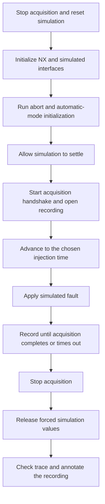

# SIMIT Scenario References

[System connections](../docs/architecture.md) | [Data and labels](../data/README.md)

These text files transcribe selected scenario scripts from the project's SIMIT screenshots. They preserve the virtual commissioning workflow, but are **not a self-contained simulation project**. They have not been compiled or executed against SIMIT as part of this repository's Python checks.

**Simulation only.** Use an isolated PLCSIM Advanced instance with no physical outputs connected. These files are not instructions for overriding safety signals on a real machine. Do not import or execute them on a live plant.

## Included Scenarios

| Case | Script | Purpose |
|---|---|---|
| 0 | [test_normal.txt](scripts/test_normal.txt) | Initialize and acquire a normal cycle |
| 3 | [test_light_curtain.txt](scripts/test_light_curtain.txt) | Change the simulated light-curtain indication |
| 4 | [test_safety_mat.txt](scripts/test_safety_mat.txt) | Change the simulated safety-mat indication |
| 6 | [test_emergency_stop.txt](scripts/test_emergency_stop.txt) | Change the virtual external-stop indication |
| 8 | [test_press_arm_sensor.txt](scripts/test_press_arm_sensor.txt) | Capture position and forward a frozen value |
| 9 | [test_shuttle_rfid_error.txt](scripts/test_shuttle_rfid_error.txt) | Suppress simulated RFID presence |
| 10 | [test_shuttle_in_station.txt](scripts/test_shuttle_in_station.txt) | Alter simulated shuttle presence |

Area-stop and door-switch recordings exist in the dataset, but complete script bodies were not available in the reviewed screenshots. No substitute scripts have been invented for them. Timings shown in these examples are not a complete enumeration of all recorded injection delays; consult the data manifest for known per-run delays.

## Dependencies

The original setup requires licensed SIMIT, NX MCD, PLCSIM Advanced, the TIA Portal project, matching tag/coupling definitions, and a DAQ handshake. The scripts reference helpers that are **not included**: `STOP_DA`, `START_DA`, `OPENFILE`, `WAIT_END_OF_DA`, `InitNXSimulation`, `SwitchMode_Abort`, and `SwitchMode_Auto`. The data acquisition client's configuration lists the shared-memory bytes these handshakes use (see [Acquisition Handshake](#acquisition-handshake)), but the helper bodies themselves are not reconstructed.

Shared-memory paths and PLC coupling identifiers must match the original engineering configuration. The press-arm experiment uses the forwarding chart's selector and `SIMIT_SHM_StuckPosition` / `SIMIT_SHM_ProvPosFault`, not an ML model.

## Experiment Lifecycle

This is a conceptual lifecycle; individual transcriptions differ in their final stop/wait statements. They are historical references, not a validated orchestration framework. A new experiment must verify cleanup and helper behavior in the simulator before collecting data.

The original acquisition configuration used shuttle-presence start/stop conditions and a maximum capture interval of approximately 30 seconds. A fixed scenario delay is not necessarily the same as elapsed time from the first saved event; that distinction matters when assigning targets from timings.

## Acquisition Handshake

The data acquisition (DAQ) client and SIMIT share the memory area `SIMITshm_DataAcquisition` (header length 8). SIMIT writes a command byte, the client carries it out and answers with an acknowledgement byte. The client controls the NX MCD simulation through a local NX Open session. These values come from the client's configuration screen:

| Command (SIMIT to client) | Byte | Acknowledgement (client to SIMIT) | Byte |
|---|---:|---|---:|
| Start NX | 10 | NX started | 11 |
| Stop NX | 20 | NX stopped | 21 |
| Restart NX | 0 | NX restarted | 1 |
| OpenFile | 30 | File opened | 31 |
| CloseFile | 40 | File closed | 41 |

Recording itself is driven by the MQTT stream. Each payload starts with seven fixed-width timestamp fields (30 characters), so character offset 30 is the first signal, `Shuttle_in_Station_von_St10`. The client starts a recording when that value becomes 1 and stops when it returns to 0, or after 30 000 ms. Event-driven files store a payload only when the text from offset 30 onwards differs from the previous one, so timestamps alone never create a row. The client can write a time-series file and an event-driven file in parallel. The dataset uses the event-driven files.

In the reviewed handshake log of a normal run, acquisition started one second after the `Open File` handshake and stopped eight seconds later. The client then completed the `Close File` handshake by itself, without a close command from SIMIT.